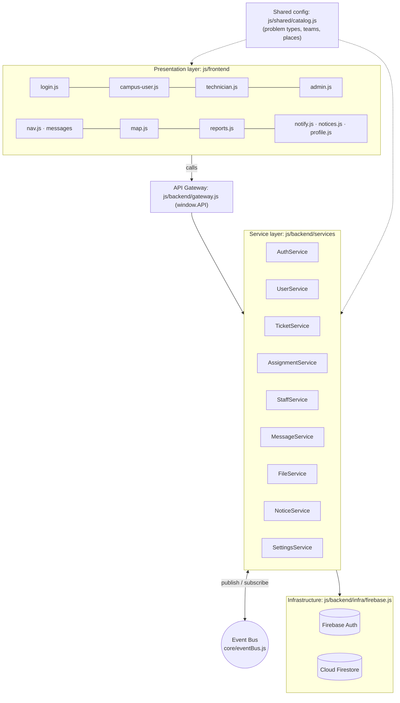
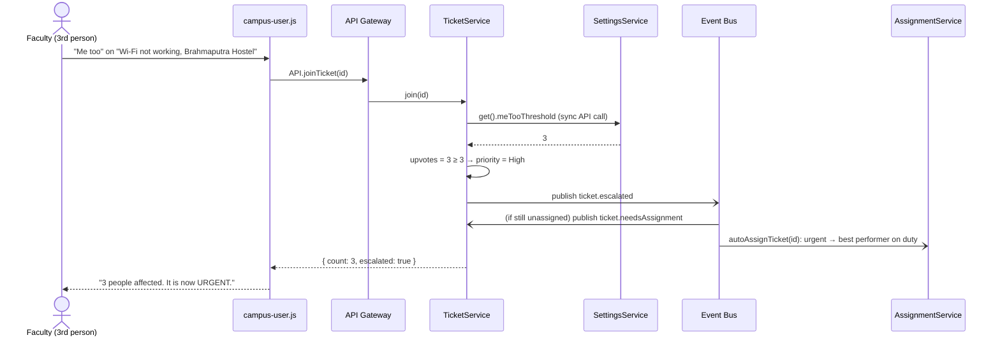
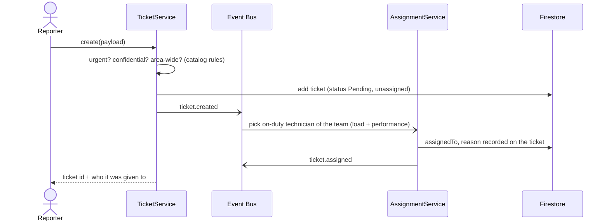
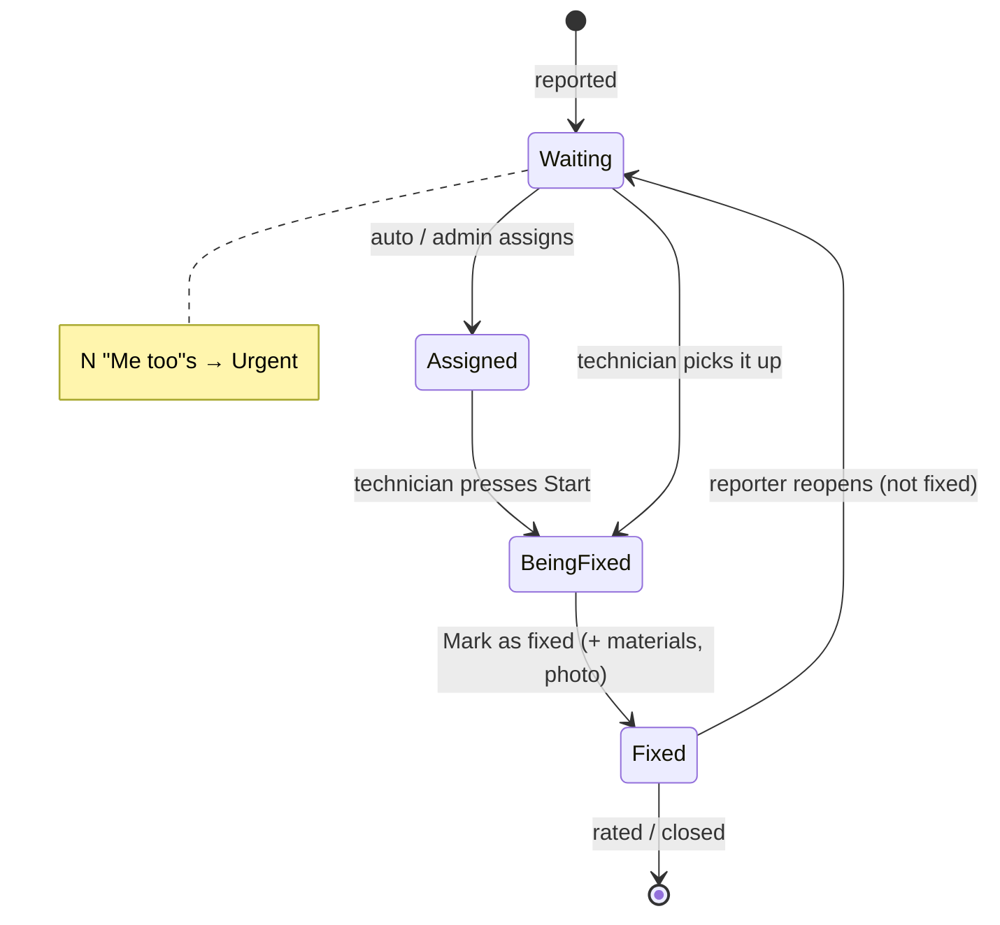

# CampusCare: Software Architecture

**CampusCare** is the campus service & grievance platform for IIIT Guwahati.
Anyone on campus (students, faculty and non-teaching staff) reports a problem; the system routes it to the right
technician, tracks it to completion, and gives the administration data to act on.

---

## 1. Why not just a Google Form?

| Need | Google Form | CampusCare |
|---|---|---|
| Report a problem | ✅ | ✅ with photo, exact map pin on campus, auto-filled profile |
| Stop 30 people reporting the same Wi-Fi outage | ❌ 30 rows in a sheet | ✅ **duplicate detection** shows the existing issue → **"Me too"** |
| Escalate when many are affected | ❌ manual | ✅ auto-**urgent** after N "Me too"s (admin sets N) |
| Send it to the right person | ❌ someone forwards e-mails | ✅ **auto-assignment** by team, availability, workload and performance |
| Know the status | ❌ reporter never hears back | ✅ live status, chat with the technician, notifications |
| Technician's side | ❌ none | ✅ work queue, Start / Mark fixed, materials used, directions |
| Confirm the fix | ❌ | ✅ rating, **reopen** if not fixed |
| Tell everyone about a known outage | ❌ | ✅ **campus notices** shown to all and inside the report form |
| Confidential complaints (ragging) | ❌ shared sheet | ✅ admin-only tickets |
| Management reports | ❌ manual pivot tables | ✅ dashboard, per-technician hours, repeat problems, materials, Excel/PDF |
| Who can do what | ❌ anyone with the link edits the sheet | ✅ role-based access (campus user / technician / admin) |

---

## 2. Architectural style

**Service-Oriented Architecture (SOA) in a layered, modular client, on a serverless backend (Firebase).**

### Options considered

| Style | Pros | Cons | Verdict |
|---|---|---|---|
| **Monolith** (one big file / module) | Simplest to start | Everything coupled; one change breaks others; hard to test, hard to split later | ❌ this is what the project was originally (`api.js`, 700 lines) |
| **Microservices** (each service a separately deployed server) | Independent scaling & deployment | Needs servers, network calls, service discovery, DevOps; Firebase Cloud Functions need the paid Blaze plan; overkill for one campus | ❌ too heavy for the scale |
| **SOA, modular (chosen)** | Clear service boundaries, single API gateway, services talk through APIs **and** events, free to run, each service can later become a microservice without changing the UI | Services still deploy together | ✅ |

### How SOA is applied here

* **Services** each own one business capability and one set of data (see §4).
* **API Gateway** (`js/backend/gateway.js`): the *only* entry point for the UI. The UI never touches the database.
* **Two kinds of communication between services:**
  1. **Synchronous API calls** (request/response) when a service needs an answer to continue.
     *e.g. TicketService asks UserService for the reporter's profile, and SettingsService for the Me-too limit.*
  2. **Asynchronous domain events** through an **Event Bus** (`js/backend/core/eventBus.js`) for side-effects.
     *e.g. TicketService publishes `ticket.created`; AssignmentService subscribes and assigns a technician.
     TicketService knows nothing about how assignment works.*
* **Path to microservices:** replace the in-process event bus with Google Pub/Sub and move a service into a Cloud Function.
  The gateway keeps the same method names, so the UI does not change.

---

## 3. Layers



| Layer | Folder | Responsibility |
|---|---|---|
| Presentation | `js/frontend/ui/*`, `js/frontend/core/*`, `index.html`, `assets/` | Screens, user input, rendering, notifications. No business rules about assignment, escalation etc. |
| API Gateway | `js/backend/gateway.js` | One stable façade (`window.API`) composed from the services |
| Services | `js/backend/services/*` | Business logic, one capability each |
| Core | `js/backend/core/*` | Event bus, configuration, shared data helpers |
| Infrastructure | `js/backend/infra/firebase.js` | Firebase SDK initialisation (Auth + Firestore) |
| Shared configuration | `js/shared/catalog.js` | 17 problem categories, ~150 issues, 15 teams, campus places, materials. Edit data, not code |

---

## 4. Service catalogue

| Service | Responsibility | Main operations (API) | Publishes | Subscribes to | Data (Firestore) |
|---|---|---|---|---|---|
| **AuthService** | Sign-in, role checks (campus user / technician / admin), passwords | `login`, `verifyRole`, `resetPassword`, `updateMyPassword`, `logout` | `auth.signedIn`, `auth.signingOut` | | Firebase Auth |
| **UserService** | Profiles for students, faculty, non-teaching staff | `getMyProfile`, `saveMyProfile` | | | `users` |
| **TicketService** | Ticket lifecycle, duplicate search, "Me too" | `create`, `findSimilar`, `join`, `acknowledge`, `resolve`, `reopen`, `escalate`, `rate`, `addMessage` | `ticket.created`, `ticket.escalated`, `ticket.resolved`, `ticket.reopened`, `ticket.needsAssignment` | `ticket.escalated` | `tickets` |
| **AssignmentService** | Choose the best technician (team, on duty, workload, performance) | `pickTechnician`, `autoAssignTicket`, `autoAssignWaiting`, `assignTicket` | `ticket.assigned` | `ticket.created`, `ticket.needsAssignment`, `technician.onDuty`, `technician.removed` | reads `tickets`, `technicians` |
| **StaffService** | Technician accounts, duty status, admin-managed passwords, photo approvals, removal | `create`, `setStatus`, `resetPassword`, `getPassword`, `remove`, `requestPhoto`, `resolvePhotoRequest` | `technician.onDuty`, `technician.removed` | | `technicians`, `staff_credentials`, `profile_requests` |
| **MessageService** | Direct conversations with the Administrator | `sendToAdmin`, `adminStart`, `reply`, `markRead…` | | | `admin_messages` |
| **NoticeService** | Campus-wide notices / known outages | `post`, `end`, `subscribe` | | | `notices` |
| **SettingsService** | Admin rules: Me-too limit, late time, auto-assign on/off | `get`, `save`, `subscribe` | `settings.changed` | | `settings/app` |
| **FileService** | Photo uploads (Cloudinary or compressed inline) | `uploadFile` | | | (Cloudinary / inline) |

### Event flow example: a shared problem becomes urgent



### Event flow example: reporting a problem



---

## 5. Ticket life-cycle (state machine)


Stored values: `Pending` (Waiting / Assigned), `In Progress` (Being fixed), `Resolved` (Fixed).

---

## 6. Data model (Firestore collections)

| Collection | Key fields |
|---|---|
| `users/{uid}` | name, userType (student / faculty / staff), department, idNumber, phone, zone, spot |
| `tickets` | id, category, subCategory, location, lat/lng, priority, isPublic, confidential, status, reporter (userId, userName, reporterType, reporterDept), assignedTo / assignedAt / acknowledgedAt / resolvedAtMs, upvotes, upvotedBy[], followers[], followerIds[], availabilityWindows[], appointment, appointmentHistory[], messages[], materialsLog[], rating, reopenCount, reopenHistory[] |
| `technicians` | name, dept (team), email, phone, status (On/Off Duty), uid, photoUrl |
| `staff_credentials/{techId}` | password, temp (admin-managed; **restrict to admin**, see `firestore.rules`) |
| `admin_messages` | sender…, text, replies[], isRead, userUnread |
| `notices` | title, body, level, category, zone, expiresAt, active |
| `settings/app` | meTooThreshold, lateHours, autoAssign |
| `profile_requests` | techId, photoUrl, status |

---

## 7. Quality attributes

| Attribute | How it is achieved |
|---|---|
| **Modularity / maintainability** | One service per capability; UI only uses the gateway; problem catalogue is data (`catalog.js`) |
| **Loose coupling** | Event bus between services; e.g. assignment rules can change without touching ticket code |
| **Extensibility** | New problem type = edit `catalog.js`; new service = new file + gateway entry; new event subscriber without changing the publisher |
| **Real-time** | Firestore listeners push changes to every open screen; no refresh |
| **Usability** | Mobile-first, installable app (PWA), plain-language labels, profile auto-fill, duplicate suggestions |
| **Security** | Firebase Auth; campus-domain check; role verification; admin-only staff passwords and settings in `firestore.rules`. *Known limitation:* confidential tickets are hidden by the app, not yet by the database. Next step: a separate admin-only collection |
| **Availability / cost** | Serverless (Firebase free tier), static hosting; service worker keeps the app shell available on weak networks |
| **Accountability** | Every action is logged in the ticket timeline (who assigned, why, started, fixed, materials, reopen reasons) |

---

## 8. Folder structure

```
CampusCare/
├─ index.html                 # all screens (single-page app)
├─ manifest.webmanifest, sw.js  # installable app + offline shell
├─ firestore.rules            # recommended database security rules
├─ run_server.py              # local dev server (python3 run_server.py)
├─ assets/ (css, img)
├─ docs/ARCHITECTURE.md       # this document
└─ js/
   ├─ shared/catalog.js       # problem types, teams, places, materials (config)
   ├─ backend/
   │  ├─ gateway.js           # API Gateway → window.API
   │  ├─ core/ eventBus.js · config.js · helpers.js
   │  ├─ infra/ firebase.js
   │  └─ services/ auth · user · ticket · assignment · staff · message · file · notice · settings
   └─ frontend/
      ├─ app.js               # bootstrap + live data subscriptions
      ├─ core/ state.js · utils.js
      └─ ui/  login · profile · campus-user · report-form (3-step wizard) · technician · admin · ticket-chat · nav (messages)
              map · reports · notices · notify · account · feedback
```

## 9. Seeing the architecture live (for the demo)

Open the browser console on the running app:

```js
API._services        // the 9 services behind the gateway
API._events()        // domain events published so far, e.g. ticket.created, ticket.assigned, ticket.escalated
```
